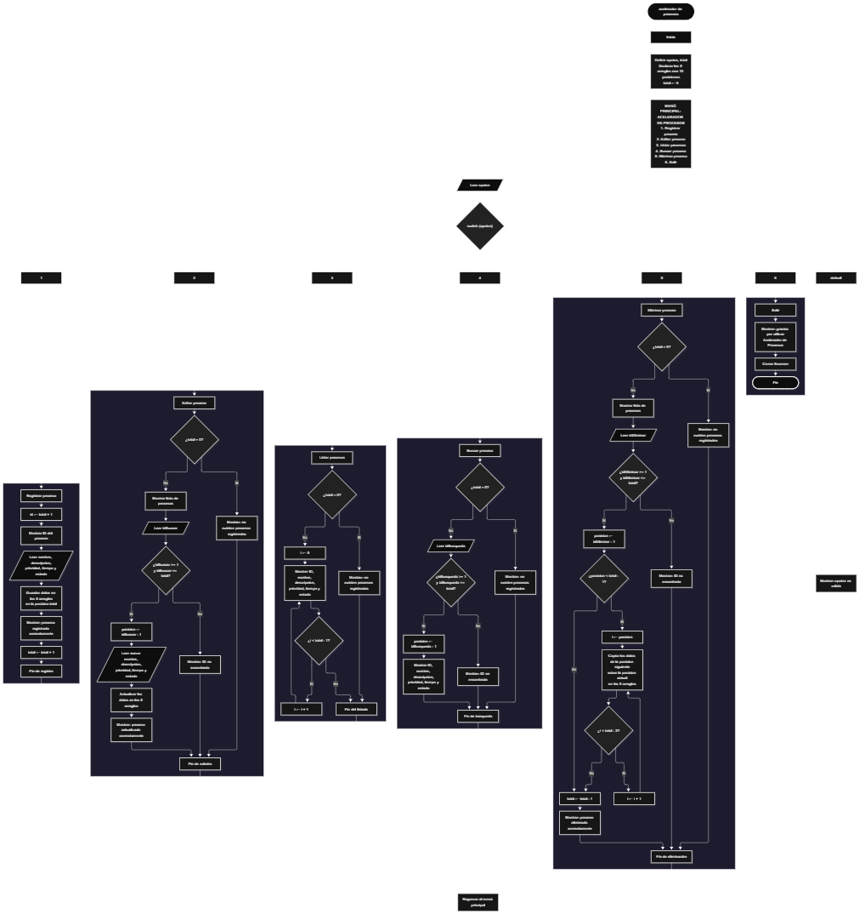

Este proyecto, llamado <b>acelerador de procesos</b>, fue desarrollado en <b>java</b> como un ejercicio práctico para fortalecer la lógica de programación mediante la creación de un sistema de gestión de procesos desde la consola. El programa cuenta con un menú principal de seis opciones que permite <b>registrar, editar, listar, buscar y eliminar</b> los procesos registrados. Cada proceso almacena datos como el nombre, la descripción, la prioridad, el tiempo estimado y el estado, utilizando arreglos con una capacidad máxima de <b>10 procesos durante la ejecución</b>. Durante su desarrollo se aplicaron conceptos fundamentales de programación, como variables, arreglos, estructuras condicionales, ciclos repetitivos y estructuras de selección, además de procesos para buscar, modificar, eliminar y organizar registros. Este proyecto permite poner en práctica los conocimientos adquiridos en Java y sirve como base para desarrollar sistemas de gestión más avanzados utilizando otros lenguajes y tecnologías.

<h2 align="center">⚙️ Funcionamiento del menú principal</h2>

### ➕ Registrar proceso

La opción <b>1) registrar proceso</b> permite almacenar un nuevo proceso en el sistema. Para identificar cada registro, el programa utiliza la variable <b>id</b>, que obtiene su valor mediante la operación <b>total + 1</b>. Después, solicita el <b>nombre, descripción, prioridad, tiempo estimado en minutos y estado</b> del proceso. Los datos se almacenan en las posiciones correspondientes de los arreglos <b>nombres, descripciones, prioridades, tiempos y estados</b>, utilizando el mismo índice para relacionar toda la información de un proceso. Finalmente, muestra el mensaje <b>"proceso registrado correctamente."</b> y aumenta la variable <b>total</b> en uno para actualizar la cantidad de registros almacenados.

### ✏️ Editar proceso

La opción <b>2) editar proceso</b> permite modificar la información de un proceso registrado. Primero, el programa comprueba si existen procesos almacenados mediante la condición <b>total == 0</b>. Si no hay registros, muestra el mensaje <b>"no existen procesos registrados."</b>. En caso contrario, presenta una lista con el ID, nombre, descripción, prioridad, tiempo estimado y estado de cada proceso. Después, solicita el identificador del proceso que se desea editar y comprueba que esté dentro del rango permitido mediante la condición <b>idBuscar &gt;= 1 && idBuscar &lt;= total</b>. Si la selección es válida, utiliza la variable <b>posicion</b> para obtener el índice correspondiente mediante la operación <b>idBuscar - 1</b>. A continuación, solicita el nuevo nombre, descripción, prioridad, tiempo estimado y estado, actualizando directamente los valores de los arreglos correspondientes. Finalmente, presenta el mensaje <b>"proceso actualizado correctamente."</b>. Si el ID seleccionado no corresponde a un proceso registrado, muestra el mensaje <b>"ID no encontrada."</b>.

### 📋 Listar procesos

La opción <b>3) listar procesos</b> permite visualizar todos los procesos registrados actualmente en el sistema. Antes de mostrar la información, el programa comprueba si la variable <b>total</b> es igual a cero. Si no existen registros, presenta el mensaje <b>"no existen procesos registrados."</b>. Si hay procesos disponibles, utiliza un ciclo <b>for</b> para recorrer los arreglos desde la primera posición hasta la cantidad total de procesos registrados. Durante el recorrido, muestra el ID, nombre, descripción, prioridad, tiempo estimado en minutos y estado de cada proceso. Esta función facilita consultar los registros existentes sin necesidad de buscar cada proceso individualmente.

### 🔎 Buscar proceso

La opción <b>4) buscar proceso</b> permite localizar un proceso mediante su identificador. Primero, el programa comprueba si existen procesos registrados. Si el sistema está vacío, muestra el mensaje <b>"no existen procesos registrados."</b>. En caso contrario, solicita el ID del proceso que se desea buscar y almacena el valor introducido en la variable <b>idBusqueda</b>. Después, comprueba que el identificador esté dentro del rango permitido mediante la condición <b>idBusqueda &gt;= 1 && idBusqueda &lt;= total</b>. Si el ID es válido, utiliza la variable <b>posicion</b> para obtener la posición correspondiente mediante la operación <b>idBusqueda - 1</b> y muestra todos los datos del proceso encontrado: <b>nombre, descripción, prioridad, tiempo estimado y estado</b>. Si el identificador no corresponde a ningún registro, presenta el mensaje <b>"ID no encontrada."</b>.

### 🗑️ Eliminar proceso

La opción <b>5) eliminar proceso</b> permite eliminar un proceso registrado mediante su identificador dentro de la lista. Antes de comenzar, el programa comprueba que existan procesos almacenados. Si el sistema está vacío, muestra el mensaje <b>"no existen procesos registrados."</b>. Si hay registros disponibles, presenta una lista con el ID, nombre, descripción, prioridad, tiempo estimado y estado de cada proceso. Después, solicita el ID del proceso que se desea eliminar y verifica que la selección esté dentro del rango válido mediante la condición <b>idEliminar &gt;= 1 && idEliminar &lt;= total</b>. Si el proceso existe, utiliza la variable <b>posicion</b> para identificar su ubicación y comienza el proceso de eliminación. Para mantener los registros organizados, utiliza un ciclo <b>for</b> que desplaza una posición hacia la izquierda los datos de los procesos posteriores en los arreglos <b>nombres, descripciones, prioridades, tiempos y estados</b>. Posteriormente, disminuye la variable <b>total</b> en uno y muestra el mensaje <b>"proceso eliminado correctamente."</b>. Si el ID seleccionado no corresponde a un proceso registrado, informa mediante el mensaje <b>"ID no encontrada."</b>.

### 🚪 Salir del menú principal

La opción <b>6) salir</b> está destinada a finalizar la ejecución del programa y muestra el mensaje <b>"gracias por utilizar acelerador de procesos."</b>. El menú principal se encuentra dentro de una estructura repetitiva <b>do-while</b>, que mantiene el programa en funcionamiento mientras el usuario realiza las operaciones disponibles. La condición del ciclo es <b>opcion != 6</b>, por lo que el menú continúa mostrándose mientras la opción seleccionada sea diferente de seis. Cuando el usuario selecciona la opción 6, el ciclo finaliza y posteriormente se ejecuta <b>entrada.close()</b>, que cierra el objeto Scanner utilizado para capturar los datos ingresados por el usuario.

<h2 align="center">🧠 Temas aplicados en el proyecto</h2>

### 📦 Variables

En este proyecto se utilizan variables para almacenar los datos ingresados por el usuario, controlar la cantidad de procesos registrados, guardar la opción seleccionada en el menú, identificar los procesos que se desean editar, buscar o eliminar y determinar la posición correspondiente dentro de los arreglos. Cada variable cumple una función específica dentro de las operaciones de gestión de procesos.

🔢 **Opcion:** Almacena la opción seleccionada por el usuario en el menú principal.

📊 **Total:** Almacena la cantidad actual de procesos registrados.

🔎 **Id:** Almacena el identificador consecutivo que se asigna al nuevo proceso.

🔍 **IdBuscar:** Almacena el identificador del proceso que se desea editar.

🔎 **IdBusqueda:** Almacena el identificador del proceso que se desea buscar.

🗑️ **IdEliminar:** Almacena el identificador del proceso que se desea eliminar.

📍 **Posicion:** Permite obtener el índice correspondiente al proceso seleccionado mediante la operación de restar uno a su identificador.

🔄 **I:** Funciona como contador en los ciclos <b>for</b> y permite recorrer los arreglos para mostrar y reorganizar los registros.

### 🗃️ Arreglos

En este proyecto se utilizan cinco arreglos relacionados con los datos de cada proceso. Cada arreglo tiene una capacidad de <b>10 posiciones</b> y utiliza el mismo índice para representar la información correspondiente a un mismo registro. Por ejemplo, los datos de un proceso almacenado en la posición <b>0</b> se encuentran distribuidos entre <b>nombres[0], descripciones[0], prioridades[0], tiempos[0] y estados[0]</b>. Esta organización permite recorrer, buscar, modificar, mostrar y eliminar los procesos de manera ordenada.

📝 **Nombres[10]:** Almacena los nombres de los procesos registrados.

📄 **Descripciones[10]:** Almacena las descripciones de los procesos.

⚡ **Prioridades[10]:** Almacena las prioridades asignadas a cada proceso.

⏱️ **Tiempos[10]:** Almacena los tiempos estimados de cada proceso en minutos.

📌 **Estados[10]:** Almacena los estados correspondientes a los procesos registrados.

### 🔀 Estructuras condicionales

En este proyecto se utilizan las estructuras <b>if</b> y <b>else</b> para comprobar si existen procesos registrados antes de realizar determinadas operaciones, verificar que el identificador seleccionado se encuentre dentro del rango permitido y determinar si se puede continuar con las operaciones de edición, búsqueda y eliminación. Estas condiciones permiten que el programa responda de manera diferente según la cantidad de registros almacenados y el identificador introducido por el usuario.

### 🔄 Estructuras repetitivas

En este proyecto se utilizan los ciclos <b>for</b> y <b>do-while</b>. Los ciclos <b>for</b> permiten recorrer los arreglos para mostrar los procesos registrados y acceder a sus datos. Durante la eliminación, también se utilizan para desplazar los datos de los procesos posteriores una posición hacia la izquierda. Por otro lado, el ciclo <b>do-while</b> mantiene activo el menú principal para que el usuario pueda ejecutar diferentes operaciones antes de salir del programa mediante la opción seis.

### 🎯 Estructura switch

El programa utiliza la estructura <b>switch</b> para evaluar el valor almacenado en la variable <b>opcion</b> y ejecutar el bloque de instrucciones correspondiente. Cada caso representa una operación específica del sistema: <b>registrar, editar, listar, buscar, eliminar o salir</b>. También se utiliza el bloque <b>default</b> para mostrar el mensaje <b>"opcion no valida."</b> cuando el usuario introduce un número que no coincide con ninguna de las opciones definidas en el menú principal.

### 🔢 Dimensionamiento de arreglos

El programa utiliza la creación de arreglos mediante la instrucción <b>new</b> para establecer la capacidad de almacenamiento de los datos de los procesos. Se definieron <b>10 posiciones</b> para cada uno de los cinco arreglos, lo que permite administrar hasta 10 procesos durante la ejecución. La cantidad de posiciones ocupadas se controla mediante la variable <b>total</b>, por lo que las operaciones recorren únicamente los registros comprendidos entre el índice cero y la cantidad actual de procesos registrados menos uno.

### 🔄 Reorganización de registros

Cuando se selecciona un proceso para eliminarlo, el programa utiliza un ciclo <b>for</b> que comienza en la posición seleccionada y llega hasta <b>total - 1</b>. En cada repetición, los datos de la posición siguiente se copian sobre la posición actual en los cinco arreglos: <b>nombres, descripciones, prioridades, tiempos y estados</b>. Después, la variable <b>total</b> disminuye en uno para actualizar la cantidad de procesos registrados. De esta manera, los procesos posteriores ocupan las posiciones disponibles sin dejar espacios vacíos entre los registros activos. Los identificadores mostrados se calculan según la posición actual de cada proceso dentro de los arreglos.

<h2 align="center">¿Cómo se implementaron las operaciones crud en el proyecto?</h2>

Las operaciones <b>crud</b> se implementaron mediante las opciones del menú principal, permitiendo administrar los procesos registrados. La operación <b>crear</b> corresponde a <b>registrar proceso</b>, donde se introducen los datos de un nuevo registro; <b>leer</b> se realiza mediante las opciones <b>buscar proceso y listar procesos</b>; <b>actualizar</b> corresponde a <b>editar proceso</b>, donde se modifican los datos de un proceso registrado; y <b>eliminar</b> se realiza mediante la opción <b>eliminar proceso</b>. Estas operaciones utilizan variables, arreglos, condicionales y ciclos para gestionar la información almacenada temporalmente durante la ejecución del programa.

<h2 align="center">Diagrama de flujo del proyecto</h2>

<h2 align="center">🛡️ Validaciones del programa</h2>

### 📭 No existen procesos registrados

Esta validación se utiliza en las opciones de <b>editar, listar, buscar y eliminar</b>. El programa comprueba si la variable <b>total</b> es igual a <b>0</b> y, si no existen procesos registrados, muestra el mensaje <b>"no existen procesos registrados."</b>. Esta comprobación evita continuar con las operaciones que necesitan información almacenada cuando el sistema está vacío.

### 🔢 Identificador de proceso válido

Esta validación se utiliza durante las operaciones de <b>editar, buscar y eliminar</b> para comprobar que el identificador introducido por el usuario corresponda a un proceso registrado. El programa utiliza las condiciones <b>idBuscar &gt;= 1 && idBuscar &lt;= total</b>, <b>idBusqueda &gt;= 1 && idBusqueda &lt;= total</b> e <b>idEliminar &gt;= 1 && idEliminar &lt;= total</b>, según la operación seleccionada. Si el identificador se encuentra dentro del rango permitido, el programa obtiene su posición correspondiente mediante la operación <b>id - 1</b> y continúa con el procedimiento solicitado. En caso contrario, muestra el mensaje <b>"ID no encontrada."</b>. Esta comprobación evita acceder a posiciones que no corresponden a procesos registrados.

### ❌ Proceso no encontrado

Esta validación se utiliza cuando el usuario introduce un identificador que no corresponde a ningún proceso registrado. El programa comprueba que el ID sea mayor o igual a <b>1</b> y menor o igual al valor de <b>total</b>. Si el identificador no cumple estas condiciones, ejecuta el bloque <b>else</b> y presenta el mensaje <b>"ID no encontrada."</b>. Esta comprobación permite informar al usuario cuando intenta acceder a un proceso que no se encuentra dentro de los registros disponibles.

### ⚠️ Capacidad de almacenamiento

El programa utiliza cinco arreglos con una capacidad máxima de <b>10 posiciones</b> para almacenar los datos de los procesos. La variable <b>total</b> controla la cantidad de registros almacenados y determina la posición en la que se guardan los nuevos datos. Sin embargo, en el código actual no se implementa una condición que compruebe si <b>total &lt; 10</b> antes de registrar un nuevo proceso. Por este motivo, aunque los arreglos permiten almacenar hasta 10 procesos, el programa todavía necesita incorporar esta validación para impedir que se intente registrar información cuando se alcance la capacidad máxima.

### ⚠️ Opción inválida

La estructura <b>switch</b> incluye el bloque <b>default</b>, que muestra el mensaje <b>"opcion no valida."</b> cuando el usuario introduce un número que no corresponde a ninguna de las opciones definidas en el menú principal. Esta comprobación permite informar al usuario cuando selecciona una opción que no se encuentra disponible y mantiene el funcionamiento del menú mientras no se seleccione la opción <b>6</b> para salir del programa.

<h2 align="center">🎯 Objetivo del proyecto</h2>

El objetivo principal de este proyecto es fortalecer la <b>lógica de programación</b> mediante el desarrollo de un sistema de gestión de procesos en <b>java</b>. A través de su construcción se busca aplicar los conocimientos adquiridos sobre variables, arreglos, estructuras condicionales, ciclos repetitivos y estructuras de selección, integrándolos para resolver un problema de manera organizada. Además, el proyecto permite comprender cómo registrar, consultar, modificar y eliminar información en una aplicación de consola, estableciendo una base para desarrollar sistemas de gestión más completos con otros lenguajes y tecnologías.

